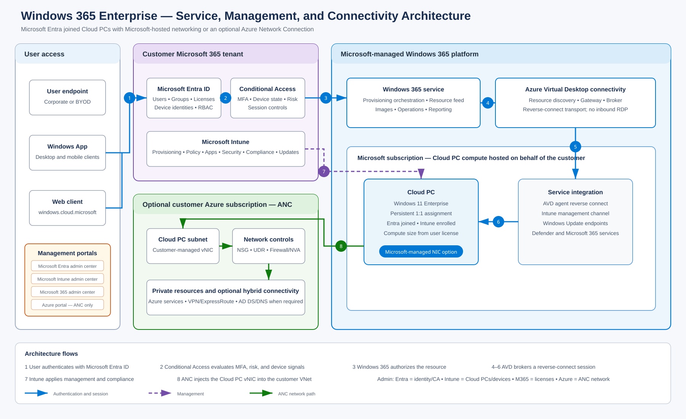

# Windows 365 Enterprise: design, deployment, and operations

A practical Windows 365 engineering guide. Start with a small pilot, record what happens, and use the same checks before a wider rollout. The repository separates Business lab observations from Enterprise procedures that still need live validation.

**New to Windows 365?** Begin with the [complete learning journey](docs/00-complete-learning-journey.md) or the [nine-part blog series](https://adnanasiddiqui.com/windows-365-enterprise/). Read [the fundamentals](docs/01-fundamentals.md), then follow [the first Cloud PC lab](docs/02-first-cloud-pc-lab.md). The use-case numbers are permanent topic IDs, not the order of deployment: the network decision (UC-03) and image choice (UC-13) come before provisioning (UC-02). [The learning path](docs/03-learning-path.md) lists every topic in the order to study it.

## Start here

| Step | What you will decide or verify | Guide |
|---|---|---|
| 1. Prepare | License, tenant roles, pilot users, and success criteria | [Tenant readiness](use-cases/UC-01-tenant-readiness-and-pilot-design.md) |
| 2. Choose a network | Microsoft-hosted network or Azure network connection; Entra join or hybrid join | [Network decision](use-cases/UC-03-network-architecture.md) |
| 3. Provision | User group, license, image, policy, and Cloud PC state | [Enterprise provisioning](use-cases/UC-02-enterprise-provisioning.md) |
| 4. Manage | Enrollment, configuration, apps, security, updates, and access | [Management path](#management-path) |
| 5. Operate | Support, lifecycle actions, user changes, and rollout | [Operations path](#operations-path) |

If you have no tenant access, you can still work through the architecture decisions and dry-run the lab worksheet. A real provisioning result requires your own eligible tenant, license, and pilot user. Start with the Microsoft-hosted network and gallery image to keep the first lab focused; build the Azure network connection variant only when a private network requirement calls for it.

**Evidence status:** The [Enterprise pilot record](evidence/UC-02-2026-09-24-portal-check.md) confirms an existing Provisioned Cloud PC, a working web session, Microsoft Entra join, and an Intune device record. The [October 12 connection check](evidence/UC-02-2026-10-12-enterprise-web-connection.md) reached an interactive desktop and recorded Provisioned and Compliant in Intune; a new provisioning run and reconnect trace remain pending. The [ANC troubleshooting lab](evidence/UC-03-2026-10-04-anc-egress-retry.md) deployed temporary egress, reran health checks, reported the failed endpoint pattern `*.infra.windows365.microsoft.com:443`, and removed the paid resources. The exact hostname and cause are not established. The ANC is not healthy and has no Cloud PCs assigned; the working Microsoft-hosted Cloud PC was not moved. Earlier Business lab work has no published logs or screenshots, and several Enterprise operations remain procedures pending a live test. Use the [validation status](docs/live-validation-status.md) to distinguish observed results from planned exercises.

## Architecture decision

| Option | Use when | Customer network work |
|---|---|---|
| Microsoft-hosted network + Microsoft Entra join | Cloud PCs mainly use internet, Microsoft 365, and SaaS apps; a separately tested VPN or private access client may reach private apps | No customer Azure network connection or subscription required for Cloud PC networking |
| Azure network connection + Microsoft Entra join | Cloud PCs need customer-controlled routing, private access, or egress | Plan VNet, subnet capacity, DNS, outbound access, and connection health |
| Azure network connection + hybrid join | AD DS device join is a firm application or policy requirement | Add domain-controller reachability, DNS, join permissions, and identity synchronization |

Choose one network option for each provisioning policy. The Cloud PC runs in the Windows 365 service; with an Azure network connection its virtual network interface attaches to the customer VNet. The Azure network connection does not place the Cloud PC VM in the customer's subscription. [Microsoft's deployment options](https://learn.microsoft.com/windows-365/enterprise/deployment-options) and [Azure network connection overview](https://learn.microsoft.com/windows-365/enterprise/azure-network-connections) explain the boundaries.

## Deployment path

1. [UC-01: tenant readiness and pilot](use-cases/UC-01-tenant-readiness-and-pilot-design.md) — define scope, roles, licenses, and acceptance checks.
2. [UC-03: network architecture](use-cases/UC-03-network-architecture.md) — make the network and join decision before creating a provisioning policy.
3. [UC-13: image and application baseline](use-cases/UC-13-image-and-application-baseline.md) — decide whether a gallery image meets the persona before building a custom image.
