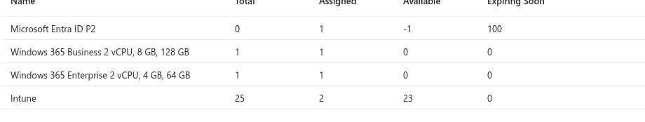
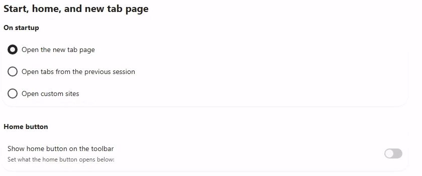
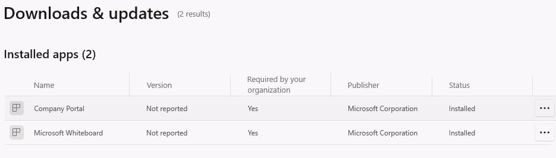
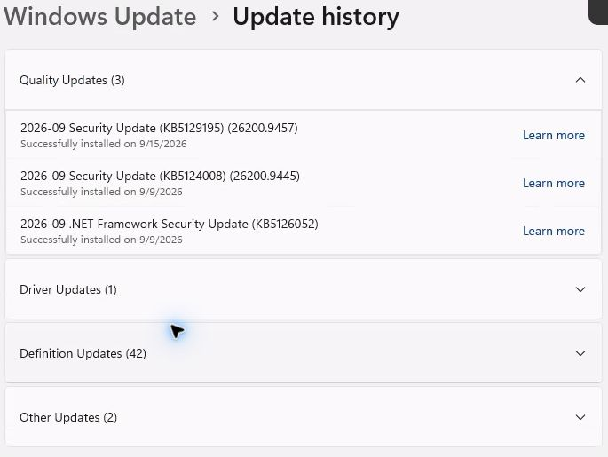
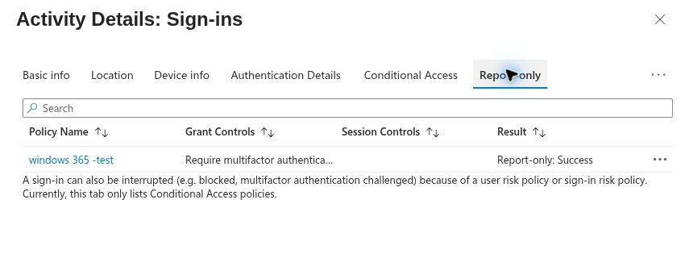
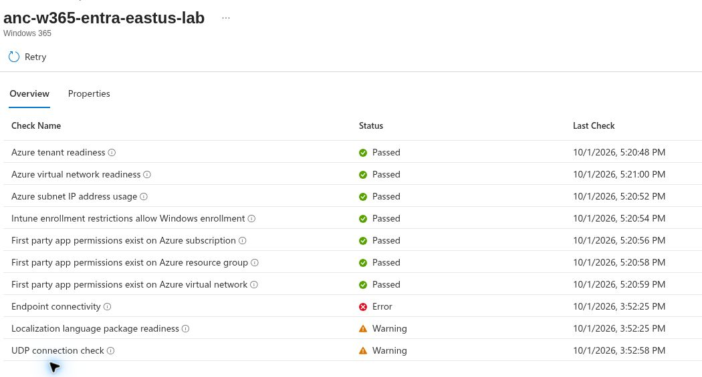

# Windows 365 Enterprise: from first decision to daily operations

This guide gives a new reader one route through the repository. Work through the first Cloud PC on a Microsoft-hosted network. Add an Azure network connection (ANC) only when a tested application or network requirement needs it. Each stage links to a deeper use case, names the result to check, and tells you what evidence to keep.

> **Lab evidence:** An existing Enterprise Cloud PC has been observed as provisioned, joined to Microsoft Entra ID, enrolled in Intune, and accessible through a web session. This repository does **not** contain a fresh, uninterrupted provisioning capture from license assignment through first sign-in. The ANC lab did not reach a healthy state. Follow the [live validation status](live-validation-status.md) for the precise record. Do not present the procedures below as completed tests.

## How to read this guide

- **Do:** the action a reader performs in their own tenant.
- **Check:** the condition that proves the step worked in that tenant.
- **Record:** a screenshot or result that can be published after private details are removed.
- **Go deeper:** the existing use case with design choices, troubleshooting, and operations notes.

Portal labels change. If a screen differs, use the linked Microsoft documentation and record the label seen in your tenant. Do not invent a screenshot or a successful result.

For an article-led version of this path, use the [Windows 365 Enterprise series](https://adnanasiddiqui.com/windows-365-enterprise/). Each article links back to the relevant engineering record.

## 1. Define a small pilot

**Goal:** One pilot user, one license, one Cloud PC, and a clear success test.

1. Identify the tenant and an administrator with the role needed to create provisioning policies. Confirm the Windows 365 Enterprise and supporting licensing requirements for the pilot user.
2. Create a dedicated pilot user group. Keep the production population out of the first assignment.
3. Write the acceptance checks before changing anything: provisioning state, user connection, join, Intune enrollment, one configuration setting, one application, and support action.
4. Record the tenant, license type, pilot group, chosen region, and date in a private worksheet. Publish redacted values only.

**Check:** the user appears in the pilot group and has the required licenses. **Record:** redacted license and group assignment views. The existing [license inventory](../evidence/UC-01-03-13-2026-09-24-capacity-review.md) shows one assigned Enterprise seat; it does not prove a fresh pilot assignment.

*Observed inventory, September 24, 2026. Use your own tenant values for the exercise.* **Go deeper:** [UC-01 tenant readiness](../use-cases/UC-01-tenant-readiness-and-pilot-design.md) and the [first Cloud PC lab](02-first-cloud-pc-lab.md).

Microsoft: [Windows 365 requirements](https://learn.microsoft.com/en-us/windows-365/enterprise/requirements).

## 2. Choose identity and network before provisioning

**First lab:** Microsoft Entra join with a Microsoft-hosted network. Select the geography and region options that fit the pilot. This path does not require a customer Azure subscription for Cloud PC networking.

**ANC variant:** If a workload needs the customer's VNet, routing, DNS, or private connectivity, plan an Azure network connection. The Cloud PC remains in the Windows 365 service; its network interface connects to the customer VNet. Hybrid Microsoft Entra join requires an ANC and additional directory dependencies.

**Check:** document why the selected path meets the application's needs. For ANC, review its health before assigning it to a provisioning policy. **Record:** network decision and, when applicable, ANC health results. **Go deeper:** [UC-03 network architecture](../use-cases/UC-03-network-architecture.md).

Microsoft: [network deployment options](https://learn.microsoft.com/en-us/windows-365/enterprise/windows-365-network-deployment-options), [ANC overview](https://learn.microsoft.com/en-us/windows-365/enterprise/azure-network-connections).

## 3. Choose the first image

Use a gallery image for a clean pilot unless a business application requires a custom image. List the apps the user must run and the language, update, and security requirements. Plan Intune application delivery separately from the base image.

**Check:** the image is available for the selected provisioning policy and fits the user persona. **Record:** image choice and reason. **Go deeper:** [UC-13 image and application baseline](../use-cases/UC-13-image-and-application-baseline.md).

## 4. Create and assign the provisioning policy

1. In the Intune admin center, open the Windows 365 provisioning policies area and create a policy for **Windows 365 Enterprise**.
2. Choose **Microsoft Entra Join** and the **Microsoft-hosted network** for this first exercise. Select the geography and available region selection that suits the pilot.
3. Choose the image from stage 3, review any configuration choices, and assign the policy to the dedicated pilot user group.
4. Review the final settings before creation. Keep a record of the policy name, group, join type, network, image, and region selection.

**Check:** the policy appears with the intended assignment and the Cloud PC progresses through provisioning to a provisioned state. If it fails, capture the displayed error and the policy settings before making a change. **Record:** policy summary and Cloud PC status with identifiers hidden. **Go deeper:** [UC-02 Enterprise provisioning](../use-cases/UC-02-enterprise-provisioning.md).

Microsoft: [create provisioning policies](https://learn.microsoft.com/en-us/windows-365/enterprise/create-provisioning-policy), [automated provisioning steps](https://learn.microsoft.com/en-us/windows-365/enterprise/automated-provisioning-steps).

## 5. Connect as the pilot user

Have the assigned user open [windows.cloud.microsoft](https://windows.cloud.microsoft/) and connect to the Cloud PC. Record the connection method and any first sign-in prompts. Verify that the session reaches the Windows desktop and that the user can disconnect and reconnect.

**Check:** the user reaches the desktop, then the same Cloud PC on reconnect if that second test is performed. **Record:** redacted user portal state and connection outcome; do not publish credentials, names, device IDs, or private addresses. The [October 12 web connection record](../evidence/UC-02-2026-10-12-enterprise-web-connection.md) confirms a desktop session on the existing Enterprise pilot. It does not prove a disconnect and reconnect in that run. **Go deeper:** the [first Cloud PC lab](02-first-cloud-pc-lab.md) and [connection article](https://adnanasiddiqui.com/windows-365/connect-verify/). Microsoft: [Access a Cloud PC](https://learn.microsoft.com/en-us/windows-365/end-user-access-cloud-pc).

## 6. Verify identity and device management

Locate the Cloud PC in the Windows 365 and Intune device views. Compare the user, device, join, enrollment, and last check-in information. If records are delayed, note the time and check again before changing the configuration.

**Check:** the assigned user, Microsoft Entra join, and Intune device record match the intended pilot. The [existing Enterprise pilot record](../evidence/UC-02-2026-09-24-portal-check.md) documents a provisioned Cloud PC and web session, but contains no public provisioning-page screenshot. **Record:** redacted Cloud PC and device views with timestamps. **Go deeper:** [UC-04 enrollment and inventory](../use-cases/UC-04-intune-enrollment-and-inventory.md).

Microsoft: [Cloud PC lifecycle](https://learn.microsoft.com/en-us/windows-365/enterprise/lifecycle), [manage Cloud PCs with Intune](https://learn.microsoft.com/en-us/windows-365/enterprise/device-management-overview).

## 7. Apply one change at a time

Test a configuration profile first. Assign it to the pilot group, sync the device where appropriate, and compare the Intune assignment status with the setting observed inside the Cloud PC. Then test one application, an update ring, and a compliance policy as separate experiments. A policy existing in the portal is not proof that the device applied it.

| Exercise | Check on the Cloud PC | Deeper guide |
| --- | --- | --- |
| Configuration | The setting's effective value matches the assignment | [UC-05](../use-cases/UC-05-configuration-management.md) |
| Application | Install status and app launch both succeed | [UC-07](../use-cases/UC-07-application-lifecycle.md) |
| Updates | Ring assignment and update state are visible | [UC-08](../use-cases/UC-08-windows-servicing.md) |
| Security and compliance | The device reports the expected check result | [UC-06](../use-cases/UC-06-endpoint-security-and-compliance.md) |

The repository has genuine, sanitized captures from later management checks:

*Edge settings, September 24, 2026. Compare the assigned profile with the device-side result in the linked UC-05 record.*

*Company Portal installed view, September 24, 2026. This does not prove a new Available assignment or uninstall test.*

*Installed update history, September 24, 2026. This does not by itself prove an update ring caused a particular installation.*

Record the setting, target group, assignment result, device result, date, and any restart or wait required. Use the repository's evidence index for examples of the distinction between observed and planned work.

Microsoft: [Intune management for Windows 365](https://learn.microsoft.com/en-us/windows-365/enterprise/windows-365-deployment-guidance-management), [update ring settings](https://learn.microsoft.com/en-us/intune/device-updates/windows/ref-update-ring-settings).

## 8. Test access and support carefully

Use a separate pilot when testing access controls. Start Conditional Access changes in report-only mode, inspect sign-in logs, and keep a recovery administrator outside a restrictive policy. For support, capture the original symptom, device state, assigned policy, and action taken. Test restart and reconnect before considering a destructive lifecycle action.

*Report-only result, October 6, 2026. Do not describe this image as an enforced access denial.*

**Check:** the user can still sign in and the observed policy outcome matches the intended decision. **Record:** redacted report-only result and support timeline. **Go deeper:** [UC-09 access](../use-cases/UC-09-conditional-access.md), [UC-12 troubleshooting](../use-cases/UC-12-monitoring-and-troubleshooting.md), [UC-10 lifecycle](../use-cases/UC-10-cloud-pc-lifecycle-operations.md).

Restore and reprovision affect user state. Read the current Microsoft procedure and create a tested recovery plan before using either on an existing Cloud PC. Microsoft: [restore a Cloud PC](https://learn.microsoft.com/en-us/windows-365/enterprise/restore-single-cloud-pc), [reprovision a Cloud PC](https://learn.microsoft.com/en-us/windows-365/enterprise/reprovision-cloud-pc).

## 9. Run the ANC variant as a separate lab

Keep the working Microsoft-hosted Cloud PC in place. Prepare the Azure subscription, VNet, subnet, DNS, and outbound connectivity for a separate test. Create the ANC, inspect each health check, and only then use a dedicated pilot policy and seat to validate provisioning through that network. Record the actual error text if health fails. Remove temporary paid networking resources when the lab ends.

*ANC health result, October 1, 2026: failed. This is troubleshooting evidence, not a successful customer-network deployment.*

**Current project result:** the earlier isolated ANC test reported a failed `*.infra.windows365.microsoft.com:443` endpoint pattern. Temporary NAT and public IP resources were removed. No healthy ANC or Cloud PC provisioning through that ANC has been proved in this repository. See the [live validation status](live-validation-status.md) before using this path as an example.

Microsoft: [ANC health checks](https://learn.microsoft.com/en-us/windows-365/enterprise/azure-network-connections), [network requirements](https://learn.microsoft.com/en-us/windows-365/enterprise/requirements-network).

## 10. Move from a pilot to an operating service

Define user personas, application owners, rollout groups, help desk ownership, maintenance windows, and cost review. Write a joiner, mover, and leaver procedure that checks the user group, license, provisioning policy, Cloud PC state, data, and access together. Use staged rollout gates and preserve a rollback path for each change.

**Check:** another engineer can repeat the pilot and explain every result from the published evidence. **Record:** dated acceptance worksheet and the remaining open issues. **Go deeper:** [UC-11 user lifecycle](../use-cases/UC-11-joiner-mover-leaver.md) and [UC-15 production rollout](../use-cases/UC-15-production-rollout-cost-and-continuity.md).

## Optional experiences

Windows 365 Boot and Switch are client experiences, not prerequisites for the first Enterprise Cloud PC. Test them only with a supported physical device and current Microsoft requirements. The older Windows Noob series also covers connection, management, restore, updates, Boot, Switch, and Offline; use that series as a topic checklist, while verifying each current procedure in Microsoft Learn and writing up your own observed results.

Microsoft: [Windows 365 Boot](https://learn.microsoft.com/en-us/windows-365/enterprise/windows-365-boot-overview), [Windows 365 Switch](https://learn.microsoft.com/en-us/windows-365/enterprise/windows-365-switch-overview).

## Coverage against the ten-part beginner series

The [Windows Noob getting-started series](https://www.windows-noob.com/forums/topic/23040-getting-started-with-windows-365-part-1-introduction/) is a useful checklist of reader questions. Its earlier portal captures are examples from their dates, not evidence from this tenant. This repository uses its own sequence and Microsoft documentation for current procedures.

| Series subject | Where to learn it here | Further work needed for a complete hands-on claim |
| --- | --- | --- |
| 1. Introduction and licensing | Stages 1–2; tenant readiness and network decision | Capture a fresh pilot license check |
| 2. Entra-joined provisioning | Stages 3–6; first Cloud PC lab | Capture one uninterrupted license-to-first-sign-in run |
| 3. Hybrid join | Stage 2; network architecture | Build and verify a separate directory-backed lab only if the required infrastructure is available |
| 4. Connection methods | Stage 5; first Cloud PC lab and connection article | Web desktop observed October 12; native app, mobile, and that run’s reconnect remain untested |
| 5. Management | Stages 6–8; management use cases and Intune article | Finish each policy and app result with device-side evidence; a controlled update ring rollout remains open |
| 6. Point-in-time restore | Stage 8; lifecycle use case | Test with a disposable pilot and a recovery plan |
| 7. Windows Autopatch | Stage 7; servicing use case | Add a dedicated eligibility, assignment, and observed result lab |
| 8. Windows 365 Boot | Optional experiences | Test on a supported physical pilot device |
| 9. Windows 365 Switch | Optional experiences | Test on a supported physical pilot device |
| 10. Windows 365 Offline | Optional experiences | Check current availability and requirements before writing a lab |

The table measures coverage, not test completion. A reader can follow the design and procedure today; only the [validation status](live-validation-status.md) establishes which actions have actually succeeded in this project.

## Evidence rule for every lab

Use **Verified** only when you have an observed result, a date, and a redacted artifact. Use **Procedure** for repeatable instructions without a local test. Use **Blocked** when a test stopped and include the exact symptom and cleanup. Never turn a planned screenshot into a claimed capture. The [validation status](live-validation-status.md) remains the source of truth for this repository's test claims.
