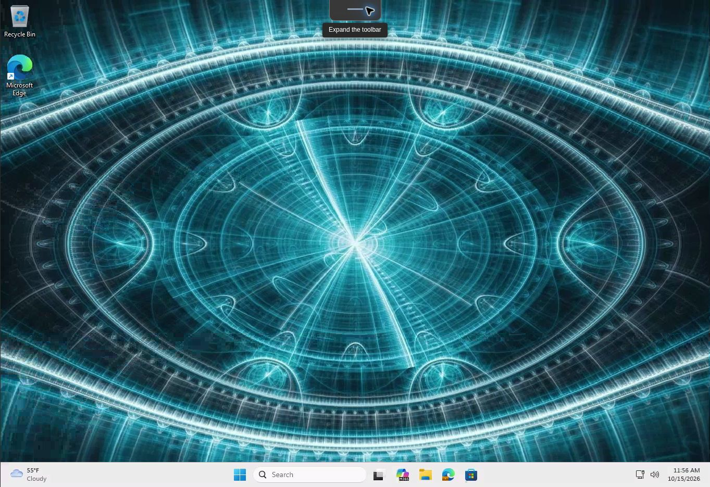

# UC-02: Existing Enterprise Cloud PC web connection

Date: 12 October 2026, about 9:50 PM Pacific time.
Environment: existing Windows 365 Enterprise Cloud PC on a Microsoft-hosted network.
Scope: the single assigned Enterprise pilot seat. No provisioning policy, license, network, or device assignment was changed for this check.

## Preconditions observed

- Intune > Devices > All Cloud PCs showed one Enterprise record with status **Provisioned**, policy **Windows 365 -Enterprise**, gallery image **Windows 11 Enterprise + Microsoft 365 Apps 25H2**, and size **2 vCPU / 4 GB / 64 GB**.
- The same device overview showed **Corporate** ownership and **Compliant** status. Its displayed last check-in was 12 October 2026, 12:53:12 PM in the portal time display; no time-zone conversion is claimed.
- The Windows App web portal displayed an Enterprise Cloud PC card for the assigned pilot user and a separate Business Cloud PC card.

## Action and observed result

1. Opened the Windows App web portal and selected the existing Enterprise Cloud PC card.
2. In the browser client, accepted the displayed in-session device settings and selected **Connect**.
3. The client displayed **Connecting...**, then **Connected**. The remote Windows desktop was visible with the taskbar and an existing Microsoft Edge window.

**Conclusion: Passed for web connection to the existing Enterprise Cloud PC.** This proves that the pilot user reached a usable remote desktop in this session. It does not prove a fresh provisioning run, application assignment, reboot, reconnection after disconnect, or ANC-based connectivity. The working Cloud PC was not moved or reprovisioned.

## Evidence handling

The 12 October original session capture was reviewed privately and was not published because it could contain private material. On 15 October 2026 at about 11:55 AM Pacific time, the same existing Enterprise Cloud PC was opened again through Windows App in a browser. The client reached an interactive desktop, and its connection information showed **Connection quality is good**. Camera and location redirection were turned off for this check. The toolbar was collapsed before capturing the desktop, leaving no visible account, tenant, or device identifier in the published image. The capture confirms the desktop and taskbar; it does not by itself show the Intune compliance state.

A browser-control timeout occurred while trying to close the remote session. A completed disconnect and successful reconnect were not observed in this check. The Cloud PC was not moved or reprovisioned. The observations above were read from the live portal and session.

## Next check

Test a complete disconnect and reconnect to the same Cloud PC, and record both states. Keep a separate record for each device-management change.
