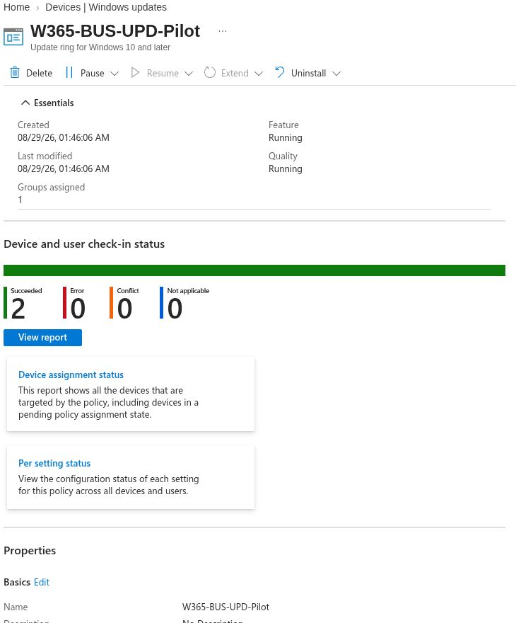
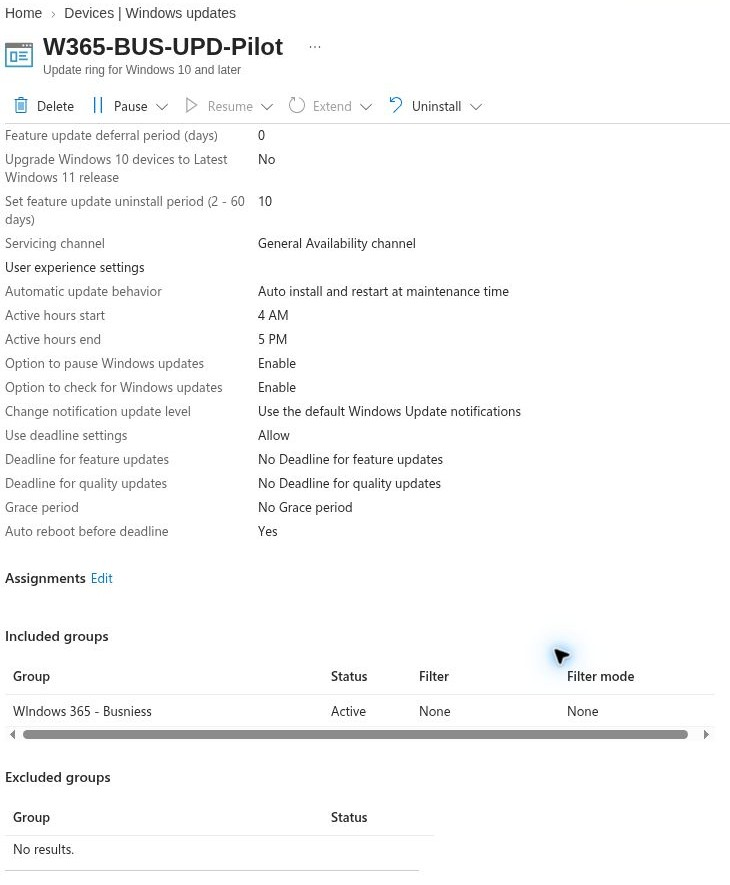
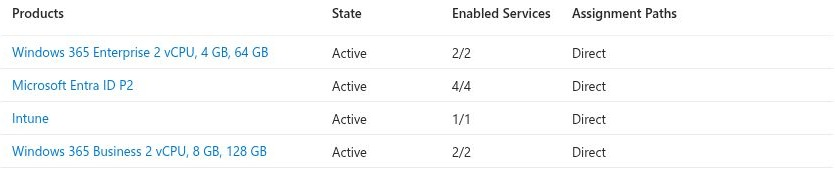

# UC-08: Windows Autopatch readiness check, 16 October 2026

## Live observations

- The existing Enterprise Cloud PC was **Provisioned** and compliant in Intune. This says nothing by itself about Autopatch registration.
- In **Devices > Windows updates > Releases**, the portal displayed one quality release, `2026.10 B`, with deployment status **In Progress** and first deployment 13 October 2026. The list did not identify the Enterprise pilot as an updated device.
- **Update rings** listed one policy, `W365-BUS-UPD-Pilot`, with quality and feature states **Running**. Its details showed one included group, `WIndows 365 - Busniess`, and no excluded group. The portal showed two succeeded check-in results for that policy, but that is not evidence of an Enterprise Cloud PC update.
- In the visible **Tenant administration** navigation, a **Windows Autopatch > Autopatch groups** blade was not present during this inspection. No Autopatch group or device-registration result was observed. The reason for the missing blade has not been established.

## Portal captures

*Figure 1. Original Intune policy overview. Two successful check-ins belong to the displayed Business-targeted policy; this does not establish an Enterprise update result.*

*Figure 2. Original Intune assignment view. The included group is Business; no Enterprise pilot group appears in this policy.*

## 17 October license follow-up

Intune **Users > All users > pilot user > Licenses** displayed four active, directly assigned products: Windows 365 Enterprise 2 vCPU/4 GB/64 GB, Microsoft Entra ID P2, Intune, and Windows 365 Business 2 vCPU/8 GB/128 GB. A Windows 10/11 Enterprise E3/E5 or Microsoft 365 F3/E3/E5 product was not listed on this user page. [Microsoft Learn prerequisites](https://learn.microsoft.com/en-us/windows/deployment/windows-autopatch/prepare/windows-autopatch-prerequisites) list Windows 10/11 Enterprise E3/E5 (including qualifying Microsoft 365 plans) for the full Autopatch service. This product list is a licensing lead to verify, not proof of why the Autopatch groups blade was absent. Check tenant entitlements and service plans, administrator role, and device registration prerequisites before attempting a rollout.

*Figure 3. Original cropped Intune product list on 17 October. The crop removes account and tenant identifiers; it does not show the service-plan details or prove Autopatch eligibility.*

## Result

**Readiness inventory only.** No Enterprise pilot Autopatch group was created, no update policy was assigned to that Cloud PC, and no before/after build or application test was performed. Do not label the Enterprise patch lab passed based on the Business ring or the release list.

## Next verification

1. Check licensing and Autopatch prerequisites, admin role and tenant feature visibility against Microsoft Learn.
2. Confirm the Enterprise Cloud PC device is absent from other update policy scopes, and create a dedicated device group and staged rollout only when a suitable endpoint and restart window are available.
3. Record the Autopatch membership report and target update, then compare device OS build, restart state, sign-in, and application behavior after deployment.

## Microsoft Learn

- [Start using Windows Autopatch](https://learn.microsoft.com/en-us/windows/deployment/windows-autopatch/prepare/windows-autopatch-start-using-autopatch)
- [Manage Autopatch groups](https://learn.microsoft.com/en-us/windows/deployment/windows-autopatch/manage/windows-autopatch-manage-autopatch-groups)
- [Prerequisites](https://learn.microsoft.com/en-us/windows/deployment/windows-autopatch/prepare/windows-autopatch-prerequisites)
